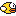

<!-- _class: title -->
<!-- _paginate: false -->



# Embedded Swiftで<br>GBAのゲームを作ろう！

Saitama.swift #1 ／ trickart

---

<!-- _class: compact -->

# 今日やること (50分)

Embedded Swift で書かれた GBA のゲーム **「FLAPPY SWIFT」** を、自分の手で改造します。

| 時間 | やること |
|---|---|
| 5分 | GBA と Embedded Swift をざっくり知る |
| 8分 | **1.** ビルドして、エミュレータで動かす |
| 7分 | **2.** コードの歩き方を知る |
| 20分 | **3.** ミッションカードを選んで改造する |
| 5分 | **4.** 実機で動かしてみる(出来たら) |
| 5分 | できたものを見せ合う・まとめ |

> 完全に別のゲームを作ってもOK!

---

# GBA はこんなマシン

2001年発売の携帯ゲーム機。**OS はありません**。電源を入れると、自分のプログラムだけが動きます。(ベアメタル)

| | ゲームボーイアドバンス | (参考) 最近のスマートフォン |
|---|---|---|
| CPU | ARM7TDMI 16.78MHz・1コア | 数GHz・複数コア |
| メモリ | **32KB** + 256KB | 数GB |
| 画面 | 240 × 160・32768色 | 1000 × 2000 以上 |
| 小数の計算 | **回路がない** | 得意 |
| OS | なし | あり |

メモリは 1万分の1 以下。それでも 1秒に60回、画面を描き替えられます。

---

# Embedded Swift とは

マイコンのような小さなマシンのための、Swift のコンパイルモードです。

<div class="cols">
<div>

## ふつうの Swift

- 大きなランタイムが必要
- 型の情報を実行時に持つ
- OS の上で動く前提

</div>
<div>

## Embedded Swift

- ランタイムがほぼ不要
- ジェネリクスはコンパイル時に展開
- OS がなくても動く

</div>
</div>

`struct` / `enum` / `class` / ジェネリクス / クロージャ / `Array` / `Optional` …  
**いつもの Swift がそのまま書けます。**

---

# いつもと違うところ

| | |
|---|---|
| 使えないもの | `Mirror` などのリフレクション、Foundation、`print` |
| 小数 (`Double` / `Float`) | 書けるが、ソフトウェアで計算するので**とても遅い** → 整数で計算する |
| 落ちたとき | エラーメッセージは出ない。**画面が固まる** |
| ハードウェア | 決まったアドレスのメモリを読み書きして操作する |

> 画面が固まったら、まず「整数の桁あふれ」と「配列の範囲外」を疑う

---

<!-- _class: chapter -->
<!-- _paginate: false -->

# 1. 動かしてみよう

準備 → ビルド → 実行

---

# 準備

Swift 6.3 以降のツールチェーンを入れます (このワークショップでは 6.4.2)。

```sh
swiftly install 6.4.2
swiftly use 6.4.2
```

リポジトリを手元に用意して、ビルドします。

```sh
cd gba-swift-workshop
make build      # build/game.mb.gba ができる
```

エミュレータは **mGBA** を使います。インストールしなくても、ブラウザ版で動かせます。

https://trickart.github.io/mgba-web/

---

<!-- _class: compact -->

# ビルドの流れ

`make build` の中では、3つのことをしています。

| やること | できるもの |
|---|---|
| 1. `swift build --triple armv4t-none-none-eabi` | GBA の CPU 向けの実行ファイル (ELF) |
| 2. `llvm-objcopy -O binary` | 中身だけを取り出した生のバイナリ |
| 3. `tools/gbafix.swift` | ロゴとチェックサムを書き込んだ **`game.mb.gba`** |

コンパイラもリンカも、Swift ツールチェーンに入っているものだけで完結します。

> `armv4t` = GBA の CPU の命令セット、`none-none` = OS なし

---

# 実行

<div class="cols">
<div>

## MacにmGBA が入っている場合

```sh
make run
```

## ブラウザ版の場合

`build/game.mb.gba` を
mGBA web のページで開く

</div>
<div>

## 遊び方

- **A ボタン**で羽ばたく
- 土管の隙間をくぐると 1点
- 土管か地面に当たるとゲームオーバー

キーボードのどのキーが A ボタンかは、エミュレータの設定で確認できます。

</div>
</div>

> ここまでできたら準備完了。まずは何回か遊んでみましょう

---

<!-- _class: chapter -->
<!-- _paginate: false -->

# 2. コードの歩き方

ゲーム本体は `Sources/Application` の直下、6ファイル・約530行

---

# ファイルの歩き方

| ファイル | 内容 |
|---|---|
| `Application.swift` | ゲームループ (入力 → 更新 → 描画) |
| **`Config.swift`** | 調整用の数値。**まずはここから** |
| `Art.swift` | 色 (パレット) と絵 |
| `Game.swift` | ゲームの進行、土管の出現、得点、画面の描画 |
| `Bird.swift` | 鳥の動き (重力と羽ばたき) |
| `Pipe.swift` | 土管の当たり判定と描画 |
| `Support/` | GBA のハードウェアを扱う部品。**読まなくても改造できる** |

---

<!-- _class: compact -->

# ゲームループ

「入力を読む → 1コマ進める → 描く」を **1秒に60回** 繰り返しているだけです。

```swift
static func main() {
    Screen.setup(skyColor: Palette.sky, palette: Palette.colors)
    var input = Input()
    var game = Game()

    while true {
        input.update()              // 1. 入力を読む
        game.update(input: input)   // 2. 1フレームぶん進める

        Screen.waitForVBlank()      //    描いてよいタイミングを待つ
        Screen.beginDrawing()
        game.draw()                 // 3. 今の状態を描く
        Screen.endDrawing()
    }
}
```

---

# 3つの状態

今どの場面かを `enum` で持ち、`update` と `draw` が `switch` で分岐します。

<div class="cols">
<div>

```swift
enum State {
    case ready      // 開始待ち
    case playing    // プレイ中
    case gameOver   // ゲームオーバー
}
```

- `ready`: A で開始
- `playing`: 当たると終了
- `gameOver`: A で最初に戻る

</div>
<div>

```swift
case .playing:
    if input.isPressed(.a) {
        bird.flap()
    }
    bird.update()

    let speed = Config.scrollSpeed
    scroll(by: speed)
    updatePipes(speed: speed)

    if isBirdHit {
        finish()
    }
```

</div>
</div>

---

# 単位は「1/256 ピクセル」

GBA には小数を計算する回路がありません。そこで、動くものの位置と速さは
**256倍した整数**で持ちます (256 で 1ピクセル)。

```swift
struct Bird {
    var y = Config.birdStartY * 256   // 上端の位置 (1/256 ピクセル)
    var velocity = 0                  // 縦の速さ。プラスが下向き
    var pixelY: Int { y >> 8 }        // 描くときはピクセルに直す (÷256)

    mutating func update() {
        velocity = min(velocity + Config.gravity, Config.maxFallSpeed)
        y += velocity
    }
}
```

`gravity = 28` なら、落ちる速さが毎フレーム 約0.11ピクセルずつ増えます。

---

# Config.swift: 数値を変えるだけで別のゲームに

```swift
enum Config {
    /// 重力: 毎フレーム、落ちる速さに足される量 (1/256 ピクセル)
    static let gravity = 28
    /// 羽ばたいた直後の速さ (1/256 ピクセル/フレーム)。マイナスが上向き。
    static let flapVelocity = -540
    /// 落ちる速さの上限 (1/256 ピクセル/フレーム)
    static let maxFallSpeed = 768

    /// 土管と地面が左へ流れる速さ。320 で 1.25ピクセル/フレーム。
    static let scrollSpeed = 320
    /// 上下の土管の隙間 (ピクセル)
    static let pipeGap = 52
    /// 土管から次の土管までの間隔 (ピクセル)
    static let pipeSpacing = 104
}
```

変えたら `make run`。この「変える → 動かす」の往復が今日のメインです。

---

# 絵は文字で描く

<div class="cols">
<div>

```swift
static let coin = SpriteImage(
    width: 8, height: 8,
    """
    ..kkkk..
    .kyyyyk.
    kywyyyok
    kywyyyok
    kyyyyyok
    kyyyyook
    .kooook.
    ..kkkk..
    """)
```

</div>
<div>


- **1文字が1ピクセル**
- 文字と色の対応は `Palette.colors`
- `.` は透明
- 色は全部で 15色まで
- 赤・緑・青はそれぞれ **0〜31**

</div>
</div>

`Art.swift` の文字を書き換えてビルドすれば、見た目がそのまま変わります。

---

# 画面の重なり順

GBA の画面は、何枚かの層を重ねてできています。手前から順に:

| 層 | 使いみち | 描き方 |
|---|---|---|
| 背景0 | 文字 (スコアなど) | `Text.draw` |
| **スプライト** | 動くもの (鳥、土管) | `Sprites.draw` |
| 背景1 | 地面 | `Background(layer: 1)` |
| 背景2 | 遠景 (丘、雲) | `Background(layer: 2)` |
| 背景3 | 未使用 | |
| 空の色 | 何も描かれていない場所 | `Screen.setSkyColor` |

土管は `priority: 2` を指定して、地面の奥に置いてあります。

---

<!-- _class: compact -->

# ゲームから使う部品

```swift
// スプライト: 毎フレーム、描きたいものを全部描く。後から描いたものほど手前
Sprites.draw(Art.bird, x: 56, y: 70)
Sprites.draw(Art.bird, x: 56, y: 70, angle: 30)      // 回転 (度)
Sprites.draw(Art.pipeEnd, x: 100, y: 40, flipY: true, priority: 2)

// 文字と数字: 位置は8ピクセル単位 (横30 x 縦20)
Text.draw("SCORE", x: 1, y: 1)
Text.drawCentered("GAME OVER", y: 5)

// キー入力
input.isPressed(.a)   // 押した瞬間の1フレームだけ true
input.isHeld(.a)      // 押している間ずっと true

// 乱数、当たり判定
let y = random.int(in: 16...68)
let hit = Rect(x: 0, y: 0, width: 8, height: 8).intersects(bird.hitbox)
```

ボタンは `.a` `.b` `.l` `.r` `.start` `.select` `.up` `.down` `.left` `.right`

---

<!-- _class: chapter -->
<!-- _paginate: false -->

# 3. 改造しよう

ミッションカードから好きなものを選ぶ

---

# ミッションの進め方


1. **★ を 1〜2枚**やって、変える → 動かすの流れに慣れる
2. **★★ か ★★★ を 1枚**選んで挑戦する
3. 余裕があれば「おまけ」や、自分で考えた改造へ
4. ぜんぜん違うゲームを作ってもOK!

お題の一覧は `README.md` の**ミッションカード**にあります。

> - 変えたら必ず `make run` で確かめる
> - 一度にたくさん変えない。動かなくなったら、直前の変更を戻す
> - 困ったら、trickartに声をかけてください。

---

<!-- _class: compact -->

# ★ 数値や1行の変更 (3〜5分)

| ミッション | ゴール | 触るところ |
|---|---|---|
| 夕焼け空 | 空を夕焼けの色にする | `Art.swift` の `Palette.sky` |
| スピード狂 | 土管が流れる速さを2倍にする | `Config.scrollSpeed` |
| 操作変更 | 十字キーの上や L ボタンでも羽ばたける | `Game.update` の `input.isPressed(.a)` |
| 月面モード | ふわふわと飛ぶようにする | `Config.gravity`, `Config.flapVelocity` |
| 鬼モード | 土管の隙間を狭く、間隔を短くする | `Config.pipeGap`, `Config.pipeSpacing` |

## 例: 夕焼け空

```swift
static let sky = rgb15(13, 23, 30)   // 赤・緑・青 (0〜31)。ここを変える
```

---

<!-- _class: compact -->

# ★★ 小さなロジックの追加 (10分前後)

| ミッション | ゴール | 触るところ |
|---|---|---|
| だんだん難しく | 得点が増えるほど速くなる | `Game.update` の `let speed = Config.scrollSpeed` |
| 滑空 | A を押している間はゆっくり落ちる | `input.isHeld(.a)` と `Bird.update` |
| ポーズ | START で一時停止と再開 | `Game.State` に状態を足す |
| 羽ばたき | 上昇中と落下中で鳥の絵を切り替える | `Bird.draw` と `Art.birdWingUp` / `birdWingDown` |
| 上を向く | 羽ばたくと上を向き、落ちるほど下を向く | `Bird.draw` の `Sprites.draw` に `angle:` |
| 動く土管 | 土管の隙間が上下に動く | `Pipe.gapY` を毎フレーム変える |

> ヒント: 鳥の今の速さは `velocity`。マイナスなら上昇中、プラスなら落下中

---

<!-- _class: compact -->

# ★★★ ルールの変更 (15〜25分)

| ミッション | ゴール | 触るところ |
|---|---|---|
| 重力反転 | B ボタンで重力の向きが逆になる | `Bird` に重力の向きを持たせる |
| 避けゲー化 | 重力をなくし、十字キーの上下で動かす | `Bird.update` と `Game.update` |
| コイン | 隙間にコインを出し、取ると得点が増える | `Art.coin` と `Rect.intersects` |

もちろん、ここにない改造も大歓迎です。

- 自分で描いたキャラクターに差し替える
- 2段ジャンプ、無敵アイテム、ボス土管 …

---

# ハマりどころ

| 症状 | 原因と対処 |
|---|---|
| 画面が固まる | 整数の桁あふれ、配列の範囲外、0 で割った。直前の変更を見直す |
| 絵が出ない・色が変 | パレットにない文字は透明になる。色は全部で 15色まで |
| スプライトの大きさでエラー | 幅と高さは 8 / 16 / 32 / 64 の組み合わせ |
| 動きがカクカクする | `Double` を使っていないか。1/256 単位の整数で計算する |
| 文字が出ない | 使えるのは 数字・英大文字・一部の記号だけ |

> 増え続ける値には `&+=` (桁あふれしても止まらない足し算) が使えます

---

<!-- _class: chapter -->
<!-- _paginate: false -->

# 4. 実機で動かしてみる

Chrome から、本物の GBA へ転送する

---

# カートリッジなしで起動する「Multiboot」

カートリッジなしの GBA は、**通信ケーブルからプログラムを受け取れます**。
ソフト 1本で対戦できるようにするための仕組みです。

`make build` でできる `game.mb.gba` が、この Multiboot 用のイメージです。

| PC の Chrome | → USB → | GBA-PICO-LINK | → 通信ケーブル → | GBA |
|---|---|---|---|---|
| GBA Multiboot Web | Web Serial | RP2040 の変換基板 | | カートリッジなし |

> 専用ソフトのインストールは不要。ブラウザだけで転送できます

---

# 用意するもの

- **GBA の実機** (カートリッジは抜いておく)
- **GBA-PICO-LINK** (ファームウェア書き込み済みのもの) と USB ケーブル
  - trickartが持ってきています。同様のピン配列であればおうちでも楽しめます
- **デスクトップ版の Chrome** (Edge でも可)
  - Web Serial を使うので、Safari や Firefox、スマートフォンでは動きません
- 転送するファイル: `build/game.mb.gba`

転送ページ:

https://trickart.github.io/gba-multiboot-web/

---

<!-- _class: compact -->

# 転送の手順

1. GBA-PICO-LINK を **USB で PC** に、**通信ケーブルで GBA** につなぐ
2. Chrome で GBA Multiboot Web を開く
3. **1. デバイス** の「**デバイスに接続**」を押し、出てきた一覧からポートを選ぶ
4. **2. ROM** に `build/game.mb.gba` をドロップする
   - タイトルやチェックサムの検査結果が表示される
5. **3. 設定** はそのまま (通信速度は 256 kHz が標準)
6. GBA を**カートリッジなしで電源 ON** し、ロゴの画面で待たせる
7. **4. 転送** の「**転送開始**」を押す

> 「転送完了」と出たら、GBA の画面で自分のゲームが動き出します

---

# うまくいかないとき

| 症状 | 確かめること |
|---|---|
| 「Web Serial に対応していません」 | デスクトップ版の Chrome / Edge で開いているか |
| ポートが他のアプリで開かれている | シリアルポートを掴んでいるターミナルなどを閉じる |
| GBA が見つからない | ケーブルの接続。カートリッジを抜いて電源を入れたか |
| 転送の途中で失敗する | ケーブルを挿し直す。通信速度が 256 kHz になっているか |
| ROM を使用できない | `make build` し直して、`build/game.mb.gba` を選んだか |

電源を切るとプログラムは消えます。改造したら、また転送すれば OK です。

---

<!-- _class: chapter -->
<!-- _paginate: false -->

# 5. 舞台裏

`Support/` の中では何が起きているのか (時間があれば)

---

# ハードウェアは「メモリ」

GBA のハードウェアは、**決まったアドレスのメモリを読み書きする**だけで操作できます。

```swift
enum Reg {
    static let dispcnt: UInt = 0x0400_0000   // ディスプレイ制御
    static let vcount: UInt = 0x0400_0006    // 現在の走査線
    static let keyinput: UInt = 0x0400_0130  // キー入力 (0=押下)
}

// キー入力を読む
current = ~mmioRead16(Reg.keyinput) & 0x03FF

// 空の色を変える = パレットの先頭に色を書く
videoWrite16(Memory.backgroundPalette, color)
```

`Sprites.draw` も `Text.draw` も、最後はこうしたメモリへの書き込みになります。

---

# 1/60 秒を待つ

画面は上から 1行ずつ描かれます。160行を描き終えてから次のコマが始まるまでの
短い休み時間を **VBlank** と呼び、この間に画面のデータを書き換えます。

```swift
/// 画面の書き換えに安全なタイミング (VBlank) が始まるまで待つ。
static func waitForVBlank() {
    while mmioRead16(Reg.vcount) >= 160 {}
    while mmioRead16(Reg.vcount) < 160 {}
}
```

「今どの行を描いているか」を読み続けて、160行目になるのを待っているだけです。
これが 1秒に約60回やってくるので、ゲームの 1フレームの区切りになります。

---

# OS がないので、全部自分で用意する

`main` が呼ばれるまでの準備も、足し算より難しい計算も、このリポジトリの中にあります。

| ターゲット | 役割 |
|---|---|
| `Startup` | 電源が入ってから `main` を呼ぶまで (`crt0.S`) |
| `MemoryPrimitives` | `memcpy` / `memset` など |
| `HeapAllocator` | `Array` などが使うメモリの確保と解放 |
| `IntegerArithmetic` | 割り算など (GBA の CPU には割り算の命令がない) |
| `SoftFloat` | 小数の計算をソフトウェアで行う |
| `linker/gba.ld` | プログラムをメモリのどこに置くか |

興味がわいたら、`make disasm` で Swift がどんな機械語になったかも覗けます。

---

# まとめ

- **Embedded Swift** なら、OS のない小さなマシンでも、いつもの Swift が書ける
- ゲームは「入力 → 更新 → 描画」を 1秒に60回繰り返しているだけ
- 小数がなくても、**256倍した整数**で滑らかに動かせる
- ハードウェアは、決まったアドレスのメモリを読み書きして操作する
- できたゲームは、ブラウザから**本物の GBA** に送って動かせる

## このあと

- 作ったものを見せ合いましょう
- リポジトリはそのまま持ち帰って、続きをどうぞ

---

<!-- _class: title -->
<!-- _paginate: false -->


# Happy Hacking!

Saitama.swift #1 ／ trickart
